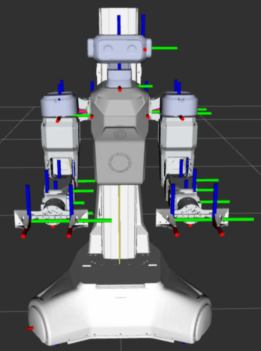

# Standard Robot Python SDK

通过 Zenoh 控制 Standard 双臂机器人，Python 3.8+，客户端无需安装 ROS2。

## 安装与连接

在仓库目录安装：

```bash
python3 -m pip install -e .
```

机器人使用配套 `standard-wifi-vr:protected` 镜像。在 NUC 执行：

```bash
sudo bash /opt/wifi-delivery/select-mode.sh sdk
```

切入 SDK 会软件上电，使双臂运动到 14 轴均为 0 rad 的电机零位；无新手臂命令时持续保持。
确认姿态稳定后再发动作。`ready` 仅表示零目标上电帧已发送，不表示实测到位。
连接、读取状态和 `wait_until_ready()` 本身不发动作命令。

```python
from mantis import Mantis

with Mantis(ip="192.168.1.100") as robot:
    print(robot.robot_sn, robot.system_status)
    robot.wait_until_ready(timeout=15)
    robot.left_arm.set_joint(0, -0.05, max_velocity=0.2,
                             max_acceleration=0.5, max_jerk=2.0)
    robot.left_gripper.open()
```

默认端口 `7447`。可传 `sn="实际SN"`，也可同时指定 IP 和 SN；不指定目标时自动发现。
SN 由各 NUC 的 WiFi MAC 生成，换机使用新机器的实际 SN。

## 调用约定

- 关节、头部和 IK 姿态使用 rad；IK 位置、滑台高度、底盘平移使用 m；底盘转角使用 degree。
- 默认 `block=True`，等待完成后返回；`block=False` 后用模块 `wait()` 或 `robot.wait()` 等待。
- 默认 `clamp=True` 将超限位置截到边界；参数必须为有限数值。
- `arm.positions`、夹爪位置、头部角度和滑台高度属性是客户端目标缓存，不是硬件实测反馈。
- `robot.stop()` / `chassis.stop()` 只停止底盘；客户端断开不会使手臂或夹爪卸力。全身紧急停止使用硬件急停。

## 手臂

左右臂使用 `robot.left_arm` / `robot.right_arm`，每侧索引 `0 ~ 6` 对应 `Degree1 ~ 7`。

| 索引 | 关节名称 | 左臂范围 rad | 右臂范围 rad |
| --- | --- | --- | --- |
| 0 | shoulder_pitch | -2.069 ~ 1.022 | -2.069 ~ 1.022 |
| 1 | shoulder_roll | -0.142 ~ 2.077 | -2.077 ~ 0.142 |
| 2 | shoulder_yaw | -1.541 ~ 1.541 | -1.541 ~ 1.541 |
| 3 | elbow_pitch | -0.529 ~ 1.355 | -0.529 ~ 1.355 |
| 4 | wrist_roll | -1.540 ~ 1.540 | -1.540 ~ 1.540 |
| 5 | wrist_pitch | -0.756 ~ 0.756 | -0.756 ~ 0.756 |
| 6 | wrist_yaw | -1.017 ~ 1.018 | -1.017 ~ 1.018 |

```python
arm = robot.left_arm
arm.set_joint(0, -0.05)                     # 只更新指定轴
arm.set_shoulder_pitch(-0.05)              # set_<关节名称> 便捷调用
arm.set_joints([-0.05, 0, 0, 0, 0, 0, 0])  # 更新该侧 7 轴
arm.home()                                # 该侧回零，有力保持
robot.set_arms_joints([0] * 7, [0] * 7)     # 一条命令更新双臂
```

上述动作及 `ik()` 支持 `max_velocity`、`max_acceleration`、`max_jerk`，单位为 rad/s、rad/s²、rad/s³。
`arm.set_speed()` 仅保存客户端兼容值；控制实际轨迹速度请显式传 `max_velocity`。
`limits` / `get_limit(index)` 读取限位。

机器人采用右手系：X 向前、Y 向左、Z 向上。双臂各关节局部轴序为 +Y/+X/+Z/+Y/+X/+Y/+Z。
左右臂均使用各自局部坐标系的右手定则，不额外翻转 SDK 角度。



### IK

```python
arm.ik(0.005, 0, 0, 0, 0, 0, abs=False)  # 相对机器人端当前目标，向前 5 mm
arm.ik(0.3298478, 0.1789957, -0.2637475, 0, 0, 0, abs=True)
```

参数顺序 `x, y, z, roll, pitch, yaw`，单位 m/rad。绝对位姿参考 `C_Link`，由机器人端解算。
零关节角下 Degree7 原点参考：左 `(0.3298478, 0.1789957, -0.2637475)`，
右 `(0.3298478, -0.1790053, -0.2637475)`，RPY 均为 0。

## 头部、夹爪和滑台

| 模块 | 常用调用 | 说明 |
| --- | --- | --- |
| 头部 | `head.set_pose(pitch=..., yaw=..., roll=...)` | 省略轴保持客户端当前目标，单位 rad |
| 头部单轴 | `set_pitch()` / `set_yaw()` / `set_roll()`、`look_left/right/up/down()`、`center()` | pitch -0.785 ~ 0.524；yaw -1.570 ~ 1.570；roll -0.349 ~ 0.349 |
| 左右夹爪 | `left_gripper/right_gripper.set_position(0.5)` | 0 闭合、1 张开；只更新指定侧 |
| 夹爪预设 | `open()` / `close()` / `half_open()` | 张开仍有力保持，当前没有夹爪单独卸力接口 |
| 滑台 | `waist.set_height(0.005)`、`move(0.005)`、`up(0.005)` / `down(0.005)` / `home()` | 相对默认硬件 -100 mm 的偏移，范围 -0.4 ~ 0.1 m |
| 滑台速度 | `waist.set_speed(0.02)` | m/s；Standard 不支持弯腰接口 |

夹爪 `set_speed()` 当前只保存客户端值，协议不传夹爪速度。
`robot.home()` 会同时控制双臂、头部、夹爪和滑台；单部件操作使用对应模块的方法。

## 底盘

```python
chassis = robot.chassis
chassis.forward(0.01, speed=0.02)
chassis.strafe_left(0.01, speed=0.02)
chassis.turn_left(2, speed=0.1)
chassis.move(x=0.01, y=0.005, angle=2, linear_speed=0.02, angular_speed=0.1)
chassis.stop()
```

`forward/backward/strafe_left/strafe_right/turn_left/turn_right` 的运动量取正数，方向由方法名决定。
`move()` 中 x 正向前、y 正向左、angle 正向左转；按先平移后旋转执行。
线速度 `0.01 ~ 0.5 m/s`，角速度 `0.1 ~ 1.0 rad/s`。
`set_default_speed(linear=..., angular=...)` 设置默认速度；
`set_friction(linear=..., angular=...)` 设置计时补偿倍率 `0.5 ~ 5.0`。

底盘按客户端计时发送停止，不是闭环位移控制。客户端被强杀或断网时，停止消息不能保证送达。
正常退出仅在本客户端发送过底盘命令时停止底盘；只读连接退出不发控制消息。

## 状态、等待与异常

| 接口或字段 | 含义 |
| --- | --- |
| `connect()` / `disconnect()`、`is_connected` | 连接管理；上下文退出自动断开 |
| `robot_sn` / `robot_ip` / `robot_version` / `supports_ik` | 机器人身份与能力 |
| `system_status`、`subscribe_status(callback)` | 当前系统状态及订阅 |
| `wait_until_ready(timeout=15)` | 等待 SDK 模式和新鲜的零目标上电帧确认 |
| `wait(names, timeout=10)`、`is_moving(names)`、`is_any_moving` | 等待或查询部件运动状态 |
| `input_mode` | 当前输入模式：`vr` / `sdk` / `none` |
| `arm_initialization` | `off` / `initializing` / `ready` / `failed` |
| `sdk_control_ready` / `arm_execution_fault` | 能否接受 SDK 动作 / 手臂执行故障说明 |

```python
robot.subscribe_status(lambda status: print(status.get("input_mode")))
robot.left_arm.set_joint(0, -0.05, block=False)
robot.wait(robot.left_arm.joint_names, timeout=10)
```

手臂等待对应命令的完成/失败回报；其他部件等待系统运动状态，不代表独立的实测到位证明。
连接失败返回 `False`，上下文连接失败抛 `ConnectionError`；参数错误抛 `ValueError`，
未就绪或执行失败抛 `RuntimeError`，等待超时抛 `TimeoutError`。

## 示例与开发

各功能示例、命令及参数见 [examples/README.md](examples/README.md)。
自动发现还可使用 `RobotDiscovery` 或 `start_robot_discovery()` / `list_discovered_robots()` / `stop_robot_discovery()`。

```bash
python3 -m examples.basic.connection_example --ip 192.168.1.100
python3 -m examples.arm.ik_pose_example --ip 192.168.1.100 --side left --mode rel
```

仓库原有单元测试：`python3 -m pytest -q`。许可证见 [LICENSE](LICENSE)。
